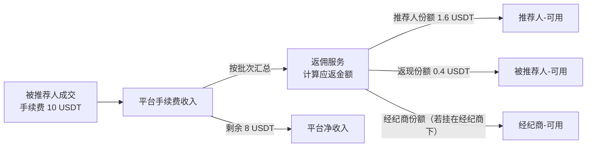
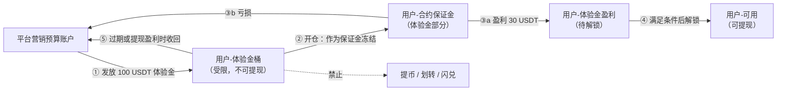
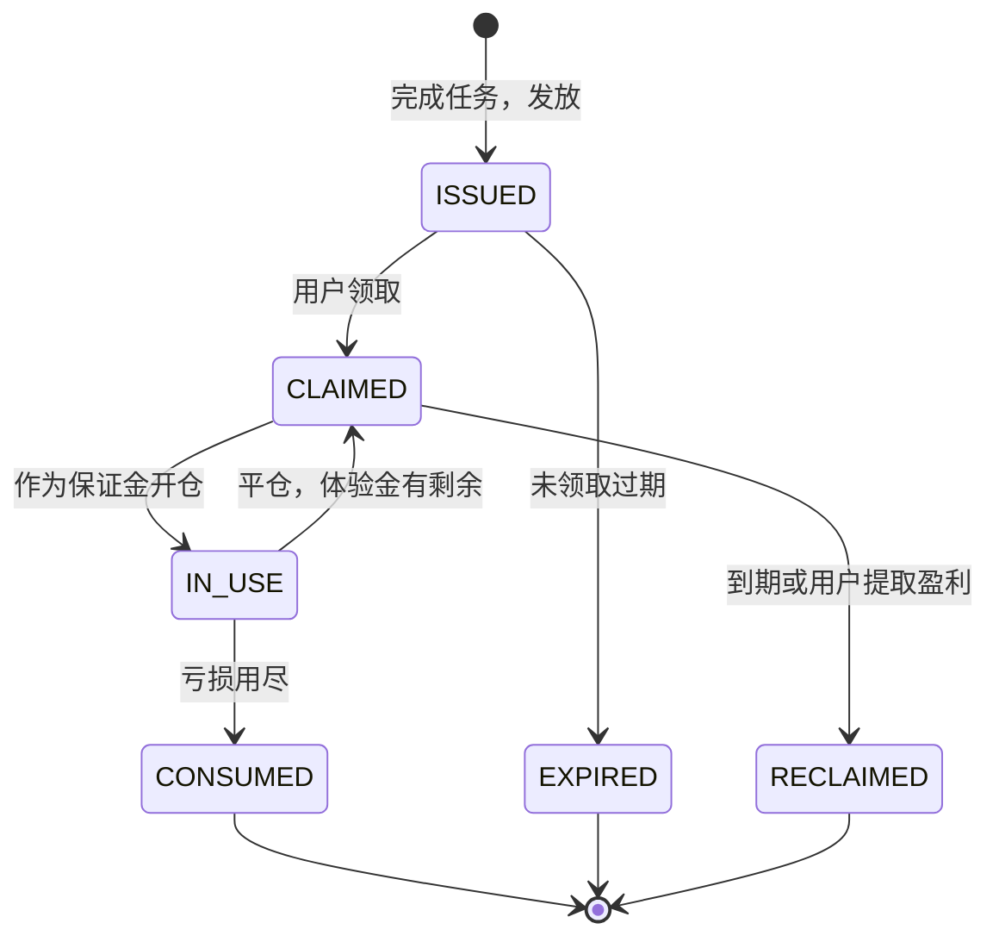
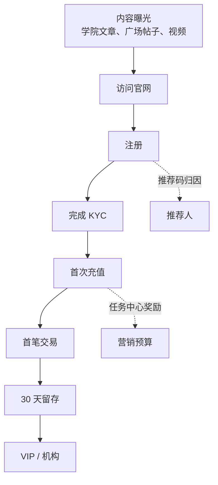
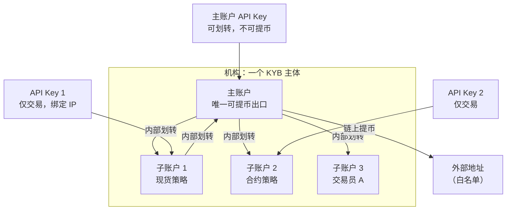
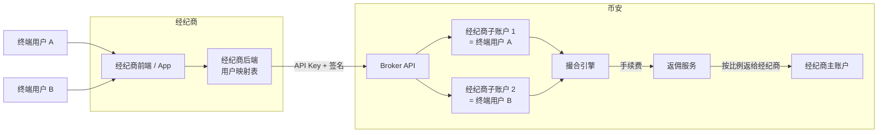
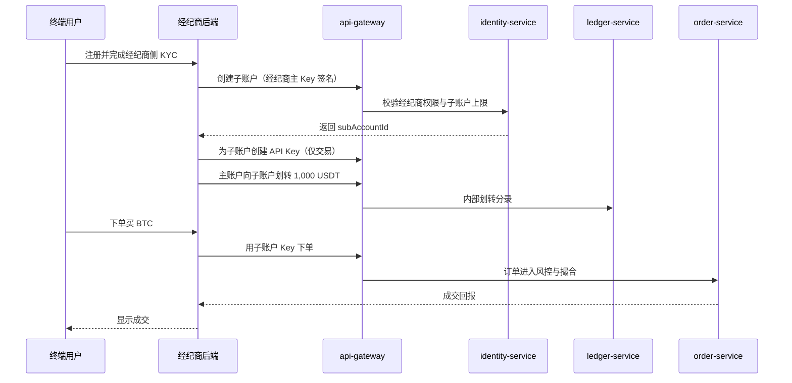
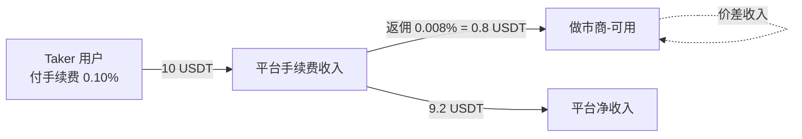
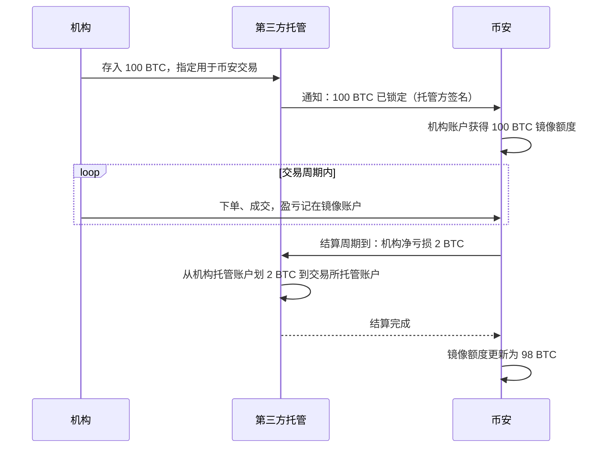

# P11 增长与机构：返佣、营销资产、VIP、经纪商、做市商、场外结算

> 学习目标：读完本章，你能——
> 1. 设计一种"受限资产"账本（体验金、抵扣券），说清它能做什么、不能做什么。
> 2. 画出主账户 / 子账户 / 经纪商子账户三种账户树，以及资金和 API 权限的边界。
> 3. 说明做市商计划的考核指标、负 Maker 费率的账本做法，以及场外结算（Off-Exchange Settlement）如何降低机构的交易所对手方风险。
>
> 前置章节：[../07-clearing-settlement-fees.md](../07-clearing-settlement-fees.md)（VIP 费率表、返佣分录，本章不重复）、[../03-account-identity-security.md](../03-account-identity-security.md) 第 3.5、3.7 节（API Key、子账户）、[../12-business-model.md](../12-business-model.md) 第 3.2 节（做市商计划）、[../05-ledger.md](../05-ledger.md)
> 交互实验：[../interactive/revenue-model.html](../interactive/revenue-model.html)（返佣与营销成本对收入的影响）、[../interactive/ledger-double-entry.html](../interactive/ledger-double-entry.html)（手续费与返佣计算器）、[../interactive/market-surveillance.html](../interactive/market-surveillance.html)（做市商与刷量识别）

## 0. 一句话理解

增长产品负责"把人带进来、让人留下来"。机构产品负责"把大资金和专业流动性接进来"。两者在账本上的共同点是：平台把一部分手续费或补贴记成支出，换取交易量和深度。

> 🎯 打个比方：交易所像一家大型超市。推荐返佣是"老顾客带新顾客，收银台按新顾客消费给老顾客发提成"。体验金是"只能在店里用、不能换现金的购物卡"。经纪商是"在超市里开专柜的品牌商，顾客挂在专柜名下，超市按销售额给专柜分成"。做市商是"超市请来的批发商，保证货架永远不空，超市给他进货价补贴"。场外结算是"大客户不把现金存进超市，而是存在第三方保管箱，超市凭保管箱的凭证给他赊账"。

## 1. 推荐返佣（Referral）

### 1.1 用户看到什么

返佣比例、返现（Kickback）和基础分录已经在 [../07-clearing-settlement-fees.md](../07-clearing-settlement-fees.md) 第 3.6 节讲过。本节只补充"分账流程"和多级关系。

返佣比例的来源分两层：

- **官方**（币安学院《Referral Pro Mode》）：推荐人可以用进度条设置现货和合约的返现比例，把佣金的一部分让给被推荐人，最多 20%。如果推荐人的佣金比例低于 20%，可以全部让出。每个账户最多创建 50 个推荐码。推荐关系在注册时绑定，之后不能更改或解除。官方页面没有给出基础佣金比例。
- **第三方**：现货基础佣金历史上为 20%，持有 500 BNB 及以上最高 40%；2024 年 3 月起，部分地区下调到 10%–15%。合约为 10%–20%。部分第三方资料写"可让出 0%–50%"，与官方"最多 20%"的说法不一致，本章以官方为准。

### 1.2 资金流（分账流程）



**读图要点**

- 示例：返佣 20%，推荐人让出 20% 给被推荐人。2 USDT 返佣拆成 1.6 + 0.4。
- 一个用户只能挂在一个上级下。推荐关系在注册时绑定，之后不可改（币安学院《Referral Pro Mode》）。这避免了同一笔手续费被返两次。
- 出错点：返佣服务按批次运行。如果批次重跑，没有幂等键，同一批返佣会发两次。幂等键通常是"用户 + 结算周期"。

### 1.3 风险

- **自我推荐刷返佣**：用户用小号推荐自己，相当于自己给自己打折。平台用设备指纹、KYC 关联识别，见 [B05-business-risk.md](../backstage/B05-business-risk.md)。
- **刷量**：推荐人与被推荐人对敲，制造手续费换返佣。返佣比例低于 100%，所以纯对敲亏钱；但叠加营销奖励后可能有利可图。

## 2. 任务中心与营销活动（受限资产）

### 2.1 用户看到什么

- 任务中心（Rewards Hub）：完成"首次充值""首笔合约交易"等任务，领取奖励。
- 奖励类型（业界通用分类）：
  1. 现金券：直接发放到可用余额，可提现。
  2. 手续费抵扣券：下单时抵扣手续费，不能提现。
  3. 体验金（Trial Fund）：可用作合约保证金开仓，本金不能提现；盈利在满足条件后可提现，提现时剩余体验金被收回。这条规则在多家交易所的公开说明中一致（例如 KuCoin、BingX 帮助中心）。
  4. 理财加息券：提高某个理财产品的年化收益。

### 2.2 资金流（受限资产账本设计）

关键设计：体验金不进入用户的"可用"余额，而是进入一个独立的余额桶。它只能流向少数几个地方。



**读图要点**

- 体验金桶与可用余额是两个独立账户。提币服务只读"可用"，从结构上杜绝了提走体验金。
- 亏损先扣体验金，再扣用户自有资金（或者不允许混用）。扣款顺序必须写进规则，否则会出现"用户自有资金先亏光、体验金还剩"的争议。
- 盈利不直接进可用，要经过"待解锁"。解锁条件通常是交易量或持仓时间，防止"开仓即平仓"套利。
- 局限：科目名称为示例。币安的体验金具体规则以活动页面为准。

### 2.3 状态机（体验金）



**读图要点**

- 体验金是"一次性燃料"。它只能被消耗或被收回，不能转成可用余额。
- `IN_USE` 时如果到期，系统不能直接收回（仓位还在用）。通常的做法是等平仓后再收回。

### 2.4 定价与收益来源

```text
营销 ROI = 被获客用户生命周期手续费 ÷ 营销支出
营销支出 = 现金券 + 抵扣券实际抵扣额 + 体验金实际亏损额
```

示例：发 100 USDT 体验金。用户平均亏损 60 USDT（这 60 USDT 是平台的实际支出），并在后续 6 个月产生 300 USDT 手续费。ROI = 300 ÷ 60 = 5（示例）。体验金的妙处在于：账面"发了 100"，实际成本只等于用户亏掉的部分。

### 2.5 学院与内容（获客漏斗）

币安学院（Binance Academy）、币安广场（Binance Square）提供免费教育内容和社区。它们在漏斗顶部带来流量。



**读图要点**

- 每一层都会流失用户。KYC 和首次充值是最大的两个流失点（业界通用观察）。
- 推荐码在注册时归因，任务奖励在首充和首交时触发。两者针对漏斗不同层。
- 局限：各层转化率属于商业数据，币安未公开。

## 3. VIP 与子账户（机构的账户树）

### 3.1 用户看到什么

- VIP 等级与费率表见 [../07-clearing-settlement-fees.md](../07-clearing-settlement-fees.md) 第 3.4 节。VIP 用户获得专属客户经理、更高 API 限频、更高提币额度（业界通用做法）。
- 子账户：公开报道显示，币安 2019 年推出子账户，企业账户和 VIP 3 及以上用户可开通，最多 200 个（新闻报道，2019 年；当前数量以官网为准）。
- 主账户可以：在子账户之间划转资金；为每个子账户创建独立 API Key；设置子账户的交易权限（现货 / 杠杆 / 合约）；统一查看资产。

### 3.2 资金流与权限边界



**读图要点**

- 子账户之间、主子之间的划转是账本内部划转，不上链、无 gas。
- 风险隔离：子账户 2 的合约仓位被强平，不影响子账户 1 的资金（逐账户保证金）。
- 权限最小化：交易员的 API Key 只开"交易"，不开"提币"。即使 Key 泄露，攻击者也只能乱交易，不能转走资金。
- 出错点：主账户 API Key 若开了"划转"，泄露后攻击者可以把资金集中到一个子账户，再利用低流动性交易对转移价值。

## 4. 经纪商计划（Broker Program）

### 4.1 用户看到什么

截至 2026 年公开资料：

- 币安经纪商计划面向交易平台、钱包、金融科技公司。经纪商接入币安的流动性和深度，使用自己的品牌和前端（币安经纪商页面，第三方整理）。
- 收益模式是返佣分成：经纪商从其用户产生的手续费中获得分成，无前期接入费用。
- 两种接入方式（业界常见分类，币安公开文档中也有对应名称）：
  1. **Link 经纪商**：用户在币安有自己的账户，通过 OAuth 或 API 授权经纪商的前端代为下单。
  2. **Exchange 经纪商**：经纪商用 API 为每个终端用户在自己名下创建子账户，用户不直接接触币安。

### 4.2 资金流与架构



**读图要点**

- Exchange 经纪商模式下，币安只看到经纪商的子账户。终端用户的 KYC 责任在经纪商一侧（通常需要经纪商自己持牌，以合同为准）。
- 经纪商后端维护"终端用户 ↔ 子账户"映射。如果映射表错乱，用户 A 的资金会被显示给用户 B。
- 返佣进入经纪商主账户，不进入终端用户账户。经纪商再自行决定是否给终端用户打折。

### 4.3 调用链（经纪商为新用户开户并下单）



**读图要点**

- 所有请求都经过 `api-gateway` 的签名校验，与 [../03-account-identity-security.md](../03-account-identity-security.md) 第 3.5 节的 HMAC 签名相同。
- 经纪商的 API 限频是所有子账户共享还是单独计算，决定了经纪商能服务多少用户。这是经纪商谈判的重点（业界通用做法）。

## 5. 做市商接入

### 5.1 用户看到什么

做市商计划的基本框架见 [../12-business-model.md](../12-business-model.md) 第 3.2 节。本节补充公开参数和账本做法。

截至 2026 年公开资料（币安公告，参数会调整）：

- 币安现货流动性提供者计划（Spot Liquidity Provider Program）按周考核"Maker 成交量"或"Maker 成交量占比"。
- 一个公开的入门条件是：周 Maker 成交量达到 2,500 万美元，或周 Maker 成交量占比达到 0.05%。
- 公告显示，第 4 档 Maker 返佣从 −0.01% 调整为 −0.008%（即 0.8 个基点）。
- 连续 3 周不达标的账户会被移出计划。
- 币安还推出过面向山寨币的现货流动性计划和合约做市商计划（新闻报道）。

术语：

- 负 Maker 费率（Maker Rebate）：Maker 成交后，平台不收费，反而支付一笔返佣。
- 挂单时间占比（Uptime）：做市商在盘口维持双边报价的时间占考核时间的比例。
- 报价价差（Quoted Spread）：做市商买一价和卖一价之间的距离。

### 5.2 资金流（负费率分录）



**读图要点**

- 示例：一笔 10,000 USDT 成交。Taker 付 10 USDT，Maker（做市商）收 0.8 USDT。平台净收入 9.2 USDT。
- 负费率不是凭空发钱。它来自同一笔成交的 Taker 手续费。只要 Taker 费率大于 Maker 返佣，平台每笔成交都赚钱。
- 出错点：如果做市商自己吃自己的单（自成交），同时拿 Maker 返佣和支付 Taker 费，平台需要自成交防护（STP）阻止这种刷量。

### 5.3 做市义务指标（示例）

| 指标 | 定义 | 示例门槛 |
|---|---|---|
| 挂单时间占比 | 在盘口有双边报价的时间 ÷ 总时间 | ≥ 90% |
| 最大价差 | 双边报价的最大价差 | ≤ 0.1% |
| 最小挂单深度 | 盘口 ±1% 内的挂单金额 | ≥ 50,000 USDT |
| Maker 成交占比 | 做市商 Maker 成交量 ÷ 全市场成交量 | ≥ 0.05% |
| 极端行情在线率 | 波动率超阈值期间的挂单时间占比 | ≥ 70% |

### 5.4 低延迟接入（一般性说明）

- **主机托管（Colocation）**：传统交易所把做市商服务器放在撮合引擎所在机房。延迟可以低到微秒级。
- 加密交易所多部署在公有云。公开讨论普遍认为币安的主要服务器位于 AWS 东京区域（ap-northeast-1）。做市商把服务器部署在同一云区域，以缩短网络延迟（业界公开讨论，币安未正式公开机房信息）。
- 交易所为做市商提供的其他低延迟手段（业界通用做法）：更高的 API 限频、专用 WebSocket 接入点、批量下单接口、FIX 协议接入。
- 公平性争议：低延迟接入让做市商比普通用户更早看到行情、更快撤单。监控见 [../interactive/market-surveillance.html](../interactive/market-surveillance.html)。

## 6. OTC 与场外结算

### 6.1 用户看到什么

- 大宗 OTC：机构通过 RFQ 询价一次性成交大额，不冲击订单簿。机制见 [P02-convert-otc.md](P02-convert-otc.md)。
- 场外结算（Off-Exchange Settlement）：机构资产存在第三方托管机构，交易所按托管资产给机构"镜像"交易额度。资产不进入交易所钱包。

截至 2026 年公开资料（币安与合作方公告、新闻报道）：

- Ceffu（币安生态的机构托管方）提供 MirrorX：机构资产留在 Ceffu 托管，在币安现货、杠杆、合约交易，链下自动结算。
- 币安 Banking Triparty：支持以法币、美国国债等作为抵押品，资产存在合作银行。
- 2025 年，币安在场外结算方案中加入代币化收益资产 USYC 和 cUSDO 作为抵押品。
- 币安也与其他托管机构合作（例如 Anchorage Digital，新闻报道）。

### 6.2 资金流与结算周期



**读图要点**

- 资产始终在托管方。交易所倒闭时，机构的资产不在交易所资产负债表里。这正是 2022 年 FTX 倒闭后机构最关心的问题（见 [../13-reliability-security-incidents.md](../13-reliability-security-incidents.md)）。
- 交易所的风险反过来了：机构在两次结算之间可能亏损超过托管额度。交易所需要按 [../09-risk-control.md](../09-risk-control.md) 的保证金规则实时监控，并在结算前要求追加。
- 结算是批量、净额的，比逐笔上链便宜得多。
- 局限：结算周期、托管方签名格式、违约处理属于合同内容，未公开。

## 7. 与主线章节的依赖

| 本章内容 | 依赖主线章节 | 依赖点 |
|---|---|---|
| 返佣分录 | [../07-clearing-settlement-fees.md](../07-clearing-settlement-fees.md) | 第 3.6 节返佣与返现 |
| VIP 费率 | [../07-clearing-settlement-fees.md](../07-clearing-settlement-fees.md) | 第 3.4 节等级表 |
| 体验金账本 | [../05-ledger.md](../05-ledger.md) | 多余额桶、冻结 |
| 子账户 / API Key | [../03-account-identity-security.md](../03-account-identity-security.md) | 第 3.5、3.7 节 |
| 做市商计划 | [../12-business-model.md](../12-business-model.md) | 第 3.2 节 |
| 自成交防护 | [../06-order-matching.md](../06-order-matching.md) | 撮合规则 |
| 场外结算风控 | [../09-risk-control.md](../09-risk-control.md)、[B06-treasury-liquidity.md](../backstage/B06-treasury-liquidity.md) | 保证金、头寸 |
| 刷量与操纵 | [B05-business-risk.md](../backstage/B05-business-risk.md) | 营销作弊、做市商监控 |

**本仓库对照（CEX Demo）**：

- 账户类型：`../../packages/domain/src/index.ts` 的 `AccountType` 已有 `main`、`spot`、`funding`、`fee`。实现体验金时，可增加 `trial_fund` 和 `marketing_budget` 两种类型，提币服务只读取 `funding` 的可用余额。
- 返佣与营销分录：可用 `../../services/ledger-service/src/application/ledger-application-service.ts` 的 `postJournal` 实现，幂等键用"用户 + 周期"。
- API Key 签名：`../../services/api-gateway/src/http/api-key-signature.ts`。本仓库没有子账户和经纪商；扩展时需在 Key 上增加"所属主账户"和"权限范围"字段。
- 运营权限（RBAC）：`../../services/identity-service/src/domain/rbac.ts`，可作为子账户权限模型的参考。

## 8. 术语表

| 术语 | 英文 | 定义 |
|---|---|---|
| 返佣 | Referral Commission | 平台把被推荐人手续费的一部分付给推荐人 |
| 返现 | Kickback | 推荐人让给被推荐人的返佣份额 |
| 体验金 | Trial Fund | 只能作保证金、不能提现的营销资产 |
| 受限资产 | Restricted Asset | 在账本中单独记账、用途受限的余额 |
| 子账户 | Sub-account | 挂在主账户下、资金和 API 独立的账户 |
| 经纪商 | Broker | 用自己的前端为终端用户接入交易所流动性的机构 |
| 负 Maker 费率 | Maker Rebate | Maker 成交后平台支付返佣 |
| 挂单时间占比 | Uptime | 维持双边报价的时间比例 |
| 自成交防护 | STP, Self-Trade Prevention | 阻止同一主体的买单和卖单互相成交 |
| 主机托管 | Colocation | 把交易服务器放在撮合引擎附近 |
| 场外结算 | Off-Exchange Settlement | 资产存第三方托管，交易所按镜像额度交易，定期净额结算 |
| 三方托管 | Triparty | 机构、交易所、托管银行三方协议 |

## 9. 思考题

1. 用 [../interactive/revenue-model.html](../interactive/revenue-model.html) 调整返佣比例和营销支出。返佣从 20% 提到 40%，需要多少新增交易量才能保持平台净收入不变？
2. 体验金规则写成"亏损先扣体验金"和"亏损先扣自有资金"，哪种对平台成本更低？哪种更容易引起用户投诉？
3. 用 [../interactive/market-surveillance.html](../interactive/market-surveillance.html) 观察做市商在剧烈行情中撤单。如果考核只看周平均挂单时间，做市商可以怎样"合规地"在关键时刻撤单？你会加什么指标？
