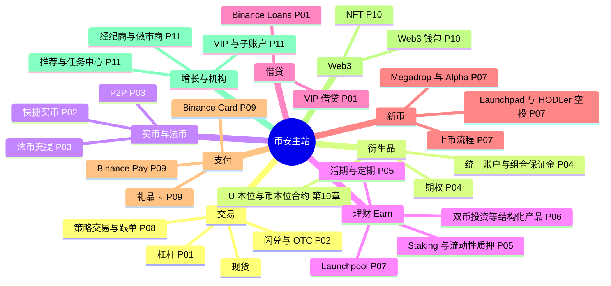

# 产品深潜：币安主站每个功能的底层逻辑

> 前置：先读完主线 01–10 章。本系列的每个产品都由主线里的"积木"拼成：账本、撮合、风控、钱包、强平。
> ⚠️ 本系列涉及杠杆、理财、期权等产品，仅用于理解系统设计，不构成投资建议。

## 1. 一句话理解

币安主站上有几十个产品入口。拆开看，它们只用了**五种底层能力**的不同组合：

| 底层能力 | 主线章节 | 一句话 |
|---|---|---|
| 托管（Custody） | [04 钱包与托管](../04-wallet-custody.md) | 用户的币放在平台控制的地址里 |
| 记账（Ledger） | [05 账本](../05-ledger.md) | 每一次所有权变化都是一组借贷分录 |
| 撮合（Matching） | [06 订单与撮合](../06-order-matching.md) | 把买卖意图配对成成交 |
| 授信（Credit） | [10 合约](../10-derivatives-futures.md) · [P01](P01-margin-and-loans.md) | 平台或其他用户先把钱借给你，用保证金兜底 |
| 定价与对冲（Pricing & Hedging） | [P02](P02-convert-otc.md) · [P06](P06-structured-products.md) | 平台报一个价，承担风险，再到市场上对冲 |

> 🎯 打个比方：币安主站像一家大型商场。店铺招牌各不相同，但水、电、收银、保安都由同一套系统供应。学会这五套系统，就能看懂任何一家新开的"店铺"。

## 2. 主站功能地图

读图要点：

- 同一种底层能力会出现在多个分支。例如"授信"同时支撑杠杆、借贷、合约和统一账户。
- 理财和借贷是同一个资金池的两面：理财用户存入，借贷和杠杆用户借出（见 P01、P05）。
- 地图只覆盖截至 2026 年公开资料中的主要入口。币安会按地区上线或下线产品。

## 3. 底层逻辑卡

本系列每个产品都用同一张"卡片"拆解，方便横向比较：

读图要点：

- 第 2 步"资金流"最关键：先问"钱从谁的账户到谁的账户"，再看界面。
- 第 5、6 步回答商业问题：平台赚的是哪一笔钱，承担的是哪一种风险。
- 第 7 步连接真实事件。产品的边界往往在极端行情中才暴露。

## 4. 目录

| 篇 | 主题 | 覆盖产品 | 交互实验 |
|---|---|---|---|
| [P01](P01-margin-and-loans.md) | 杠杆与借贷 | 全仓/逐仓杠杆、Binance Loans、VIP 借贷、利率模型 | [借贷与杠杆实验室](../interactive/margin-loan-lab.html) |
| [P02](P02-convert-otc.md) | 闪兑与 OTC | Convert（RFQ）、限价闪兑、大宗 OTC、快捷买币 | [闪兑报价沙盘](../interactive/convert-rfq.html) |
| [P03](P03-p2p-fiat.md) | P2P 与法币通道 | P2P 担保交易、申诉仲裁、商家体系、法币充提 | [P2P 担保交易](../interactive/p2p-escrow.html) |
| [P04](P04-advanced-derivatives.md) | 合约进阶 | 统一账户、组合保证金、期权、风险限额 | [永续合约实验室](../interactive/perpetual-liquidation.html) |
| [P05](P05-earn-savings-staking.md) | 理财 I：存币生息 | 活期/定期、Staking、WBETH/BNSOL、定投 | — |
| [P06](P06-structured-products.md) | 理财 II：结构化产品 | 双币投资、保本型结构化产品 | [双币投资拆解](../interactive/dual-investment.html) |
| [P07](P07-listing-launch.md) | 发币与分发 | 上币流程、Launchpad、Launchpool、HODLer 空投、Megadrop、Alpha | [Launchpool 计算器](../interactive/launchpool-calc.html) |
| [P08](P08-strategy-copy-trading.md) | 策略交易与跟单 | 网格、DCA、TWAP、跟单 | [网格策略回测](../interactive/grid-bot.html) |
| [P09](P09-pay-and-card.md) | 支付与卡 | Binance Pay、礼品卡、Binance Card | — |
| [P10](P10-web3-wallet.md) | Web3 钱包与链上 | 无私钥 MPC 钱包、DEX 聚合、NFT | — |
| [P11](P11-growth-institutional.md) | 增长与机构 | 推荐、任务中心、VIP、子账户、经纪商、做市商 | — |

## 5. 推荐阅读顺序

1. **P01 → P05 → P06**：先懂"借"，再懂"存"，最后懂"存款 + 期权"。三篇共用一个资金池视角。
2. **P02 → P03**：平台作为报价方和担保方的两种角色。
3. **P07 → P08 → P11**：增长和生态产品，偏商业逻辑。
4. **P04 → P09 → P10**：进阶与边界产品。

看完本系列后，继续读 [幕后核心](../backstage/README.md)，了解这些产品背后用户看不见的防线。
